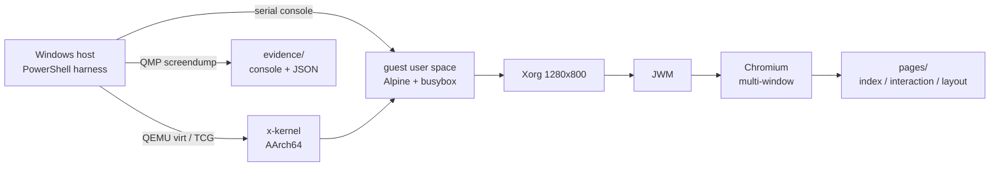

# 系统结构

目标很具体：在 **AArch64 QEMU（纯 TCG）** 上，让 **x-kernel** 跑起镜像自带的 X11 会话，
再让 **Chromium** 创建窗口、渲染指定页面、支持多窗口切换并稳定运行 10 分钟。

## 约束

| 项 | 约束 |
|---|---|
| 架构 | AArch64；QEMU ≥ 8.0（验证于 11.0.92） |
| 加速 | **纯 TCG**，初赛禁止 KVM/HVF |
| 设备 | `virtio-gpu-pci` / `virtio-input` / `virtio-blk` / `virtio-net` |
| 功能证据 | QEMU monitor `screendump` + 串口日志；每帧必须量颜色/饱和度（截图不随仓库发布） |
| rootfs | 改动必须给出 debugfs 清单 |
| 镜像 | 赛题方提供 `agentos-disk.img`，只读；所有会话用 `-snapshot` |

## 分层

四层各自解决不同问题：

| 层 | 职责 | 主要位置 |
|---|---|---|
| 内核 | 让 Chromium 需要的 syscall / ioctl / IPC 真正可用 | `kernel/`、`patches/` |
| 客机运行时 | 装页面、写 udev 元数据、起 Xorg/JWM/Chromium | `guest/*.sh` |
| 宿主 harness | 起 QEMU、送脚本、发按键、QMP 取帧、量像素、采指标 | `host/` |
| 证据 | 保存每次运行的日志与统计，供复算（截图不随仓库发布） | `evidence/` |

## 一次运行的生命周期

1. `host/xkwin.ps1` 用固定参数启动 QEMU：
   `-M virt -cpu cortex-a72 -smp 4 -m 4G -accel tcg`，挂载交付镜像的临时快照。
2. 宿主通过串口把 `guest/*.sh` 逐字节校验后送进客机，脚本落到 `/tmp/xk-<name>`。
3. 客机执行：
   - `06-fetch-pages.sh`：从宿主 HTTP 取三张页面，**在客机内**核对字节数与 SHA-256；
   - `x1-input.sh`：写 `/run/udev/data/c13:*`，让 libinput 认到 virtio 键鼠；
   - `x2-xorg.sh`：modesetting + `AccelMethod none` + `ShadowFB` + `SWcursor`；
   - `y3-jwm-stock.sh`：用镜像自带的 `/etc/system.jwmrc` 起 JWM；
   - `x4-win1.sh` / `x5c-win2.sh`：分别起两个 Chromium 窗口。
4. 宿主在每一步后发 QMP `screendump`，并用 `screen_stats.py` 量颜色数、主色占比、是否空白。
5. 需要测首帧时，`-FrameWatch` 按固定节拍抓帧；`frame_stats.py` 用饱和度判据找第一张"页面真有内容"的帧。
6. 会话结束，`console.log`、`.stats.json`、`qemu-cmd.txt`、`qemu-metrics.json` 落到 `evidence/`；PNG 不随仓库发布。

> 串口是窄带通道：单脚本 < 1792 B、单次可靠传输约 4 KB。超过就拆脚本或走 HTTP，详见
> [engineering-notes.md](engineering-notes.md)。

## 内核改动分区

完整解补丁 `patches/x-kernel-solution.patch` 涉及 **42 个文件**。按子系统看：

### 1. AF_UNIX 上的 SCM_RIGHTS（最关键）

**现象**：Chromium 主进程与 zygote 能起，但 renderer 永远不出现；日志冻在 764 字节，屏幕全黑。

**根因**：`net/knet` 的 unix stream 传输层只搬字节，把 `SendOptions::ancillary` 丢掉。
Chromium 的 Mojo 用 `sendmsg + SCM_RIGHTS` 传 fd；收不到 fd，子进程 `EnsureConnected` 超时。

**修法**：

- `AncillaryData` 由 `Box` 改 `Arc`（`MSG_PEEK` 必须借用而非移动）；
- 新增 `ControlRecord` / `StreamControl` 控制消息 FIFO；
- `send` 只在首批真正写入字节时挂控制数据；
- `recv` 以队首记录为**接收屏障**，不跨记录合并两次 `sendmsg` 的 rights；
- `posix/net` 侧按 `cmsg_len` 对齐步进，`SCM_MAX_FD=253`。

涉及：`net/knet/src/unix/stream.rs`、`unix/stream/channel.rs`、`unix/dgram.rs`、
`socket/mod.rs`、`posix/net/src/io.rs`。

### 2. ARM64：EL0 读 `CTR_EL0` 触发 SIGILL

复位值下 `SCTLR_EL1.UCT/UCI = 0`，EL0 读 `CTR_EL0` 陷入 EL1，内核未认领，异常以 **SIGILL** 交给用户态。
libgcc 的缓存同步辅助函数正好读 `CTR_EL0`，于是动态链接进程启动即崩。

修法：`boot/kernel-boot/src/arch/aarch64/mmu.rs` 的 `init_mmu()` 放行 UCT/UCI（VHE 配置除外）。

### 3. DRM legacy modeset

Xorg 的 modesetting 驱动探测 legacy `ADDFB`、要 24bpp 的 `CREATE_DUMB`、用 `MODE_CURSOR` 和
`SET_CLIENT_CAP`；缺失时 ScreenInit 完不成，画面到不了扫描输出。

修复包括：legacy `ADDFB` 翻译成 `ADDFB2`、24bpp dumb buffer、`MODE_CURSOR`、
`SET_CLIENT_CAP` 对齐 Linux 语义、`DIRTYFB` 未知 fb 返回 `ENOENT`（不是 `EINVAL`），
并附真实 fd / 真实 ioctl 的回归用例。

### 4. inotify 全链路

`inotify_init1` 原先被路由到 `sys_dummy_fd`，恒 `ENOSYS`；即使有 fd 也没有事件源。
补丁补齐：真实 fd + watch 表、事件队列、路径索引、VFS `IN_CREATE/IN_DELETE` 钩子、`FIONREAD`。
事件布局对齐 Linux：16 B 头 + NUL 结尾 name + 8 字节对齐。

### 5. tmpfs

`statfs` 报 0 容量（`df` 显示满盘）；`/dev/shm`、`/tmp` 权限 0755，非 root 进程建不了共享内存段。
修复：用 `kalloc` 的已用/可用页填 `blocks/blocks_free/blocks_available`；挂载后设 **1777**。

### 6. TCP keep-alive 与 socket 选项

Chromium 的 network service 反复设置 `TCP_KEEPIDLE / KEEPINTVL / KEEPCNT`；被拒后重试刷屏，
把串口淹掉。修复：`KEEPIDLE` 真正接到 smoltcp 的 idle 计时器；另外两个记录并可由 `getsockopt` 读回
（smoltcp 没有第二个旋钮，不伪造）。同时修非阻塞 socket 被 `EINTR` 打断导致 JWM 掉线的问题。

### 7. procfs

`/proc/<pid>/status` 补 `State / PPid / Threads / VmSize`，`stat` 补 `vsize`。
**`VmRSS` / `rss` 刻意不填 0**：MM 没有驻留页计数，凭空给数比缺字段更糟。详见 [limitations.md](limitations.md)。

### 8. 诊断（可选）

syscall 计数器与 init 交接补丁。后者**未达成目的**（busybox init 要求 PID 1），保留是为了与已提交内核一致。

## 宿主 harness

| 工具 | 作用 |
|---|---|
| `host/xkwin.ps1` | QEMU 生命周期、串口交互、QMP 截图、按键、帧观测 |
| `host/screen_stats.py` | 单张截图的颜色数 / 主色占比 / 空白判定 |
| `host/frame_stats.py` | 首帧判定、上下界、阈值敏感性 |
| `host/perf_run.py` | 6 类指标 × n 次 + 中位数/极差/CV |
| `host/perf_compare.py` | before/after 对照 |
| `host/ext4.py` | 纯 Python 读取 ext4 镜像（无 WSL/e2fsprogs 时） |
| `host/rootfs_audit.py` | 镜像内容清单与 debugfs 回放脚本 |
| `host/make_rootfs_manifest.py` | 生成 rootfs 改动清单 |

## 客机脚本分层

| 阶段 | 脚本 |
|---|---|
| 页面 | `06-fetch-pages.sh` |
| 输入 | `x1-input.sh` |
| 图形 | `x2-xorg.sh`、`y3-jwm-stock.sh` |
| 窗口 | `x4-win1.sh`、`x5c-win2.sh`、`x6-layout.sh`、`x7-interaction.sh` |
| 取证 | `y6-evidence.sh`、`v1-verify-procfs.sh`、`x8b-roles-late.sh` |
| 稳定性 | `s9-stability10.sh` |
| 性能 | `c1-perf-*.sh`、`c2-perf-*.sh` |

完整表格见 [`../guest/README.md`](../guest/README.md)。

## 证据模型

每个会话目录是**一次真实运行的全部产物**：

| 文件 | 含义 |
|---|---|
| `console.log` | 串口全量日志 |
| `NN-after-*.stats.json` | 该帧的像素统计（PNG 不随仓库发布） |
| `frame-watch.json` | 帧观测序列与首帧判定输入 |
| `qemu-metrics.json` | 宿主 QEMU 的峰值工作集、CPU 时间与分母 |
| `qemu-cmd.txt` | 完整 QEMU 命令行 |
| `run-*.txt` | 各脚本的控制台输出 |

原则：**截图成功 ≠ 画面有内容**；每个 screendump 必须有可复核的 `.stats.json`，否则不作为证据。PNG 不随仓库发布。

## 设计取舍

- **不改交付镜像**：所有运行都用 `-snapshot`；页面与 `/etc/kiosk/url` 只在运行期写入，
  另给 debugfs 清单说明"如果要固化会改什么"。
- **宿主测量优先**：客机 `/proc` 不完整，CPU/内存指标取宿主 QEMU 进程，避免用不可信读数。
- **不伪造字段**：没有驻留页计数就不填 `VmRSS=0`；没有第二个 keep-alive 旋钮就不假装支持。
- **保留失败样本**：性能批次里页面没画出来的两轮记为 `not found`，不剔除、不重跑掩盖。
